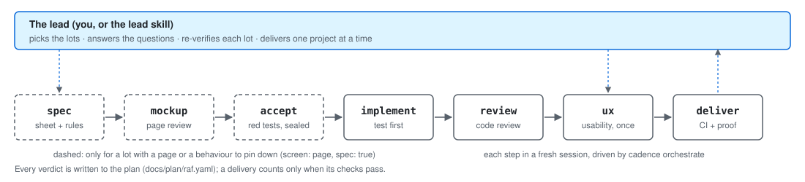

# cadence

A small working method that lives in your repository: a versioned plan linked to your commits,
waves of fresh AI sessions driven by a program, and deliveries proved by their effect.
It is for solo developers and AI-assisted sessions who lose track of *what is left to do* and *what each commit was for*:
cadence keeps both in plain files next to the code, and [Claude Code](https://claude.com/claude-code) skills turn it into rituals.
New to the words (lot, wave, hold…)? [docs/concepts.md](docs/concepts.md) explains each notion, with four figures.

## Start

Needs Node 22.18 or later (see [docs/stabilite.md](docs/stabilite.md)); waves also need Claude Code installed and logged in.

```sh
npm install -g @sylad/cadence
raf init
raf add "My first lot" --estimate 1
```

Then `raf start L1`, commit with `feat(L1): …`, `raf now` to see where you are, `raf done L1` when finished. Every command: [docs/raf.md](docs/raf.md).

## Lead several projects in 10 minutes

A parent folder, a plan in each project, a `/cadence:lead` session that picks the lots, a wave that does the work.
[docs/quickstart.md](docs/quickstart.md) goes from install to the first wave, and lists the usual stops.
Something broken or missing? [Open an issue](https://github.com/Sylad/cadence/issues/new/choose).

<picture>
  <source media="(prefers-color-scheme: dark)" srcset="docs/cycle-vague-dark.svg">
  
</picture>

## With the tools you already have

Linear, a `HANDOFF.md`, ADRs, Conventional Commits? Keep them: cadence replaces none, and each part is optional.
It can read a plan your tracker keeps (read-only) and write its plan commits in your format.
[docs/with-your-tools.md](docs/with-your-tools.md): what stays, what is optional, what plugs in.

## Install as a Claude Code plugin

```
/plugin marketplace add Sylad/cadence
/plugin install cadence@cadence        # skills and reviewer agents; needs @sylad/cadence above
/plugin install cadence-hud@cadence    # the status band, works without the CLI
```

Details: [docs/skills.md](docs/skills.md) and [docs/cadence-hud.md](docs/cadence-hud.md).

## Where to read more

- [docs/raf.md](docs/raf.md): the plan, its commands, its file, and [a lot of the lead](docs/raf.md#a-lot-of-the-lead-local-l519).
- [Waves](docs/orchestrate.md): [probe](docs/orchestrate.md#the-edge-case-probe-orchestrateprobe-l497), [express](docs/orchestrate.md#express-lane-l519).
- [Brief grid and pre-check reading](docs/mesures/brief-implementation-enrichi-avant-apres.md): grid of the code-reviewer in the `implement` brief (L523).
- [docs/deliver.md](docs/deliver.md): CI, deploy, verify, mark lots delivered (delivered ≠ finished); [remote gate](docs/remote-gate.md).
- [docs/spec.md](docs/spec.md): screen and back-end sheets.
- [docs/ref.md](docs/ref.md): reference documents (specs, norms, mock-ups) and the coverage of their elements by the lots.
- [docs/lead.md](docs/lead.md): the lead workflow, the `livreur` agent, and [the memory index warning](docs/session.md#memory-index-size-l442) (L442).
- [docs/overview.md](docs/overview.md): the longer introduction and the map of every page; [docs/fonctionnement.md](docs/fonctionnement.md): how it works.
- [docs/stabilite.md](docs/stabilite.md): what is guaranteed from 1.0.0; [docs/qualite.md](docs/qualite.md): the code-quality ratchet.
- [docs/whats-new.md](docs/whats-new.md) and [CHANGELOG.md](CHANGELOG.md): what changed.

## License

MIT
