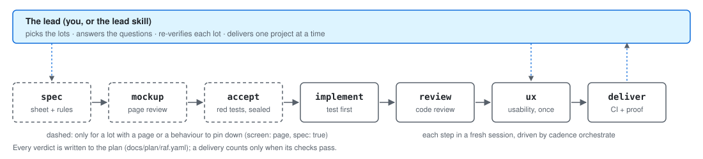

# cadence

A small working method that lives in your repository: a versioned plan linked to your commits, waves of fresh AI sessions driven by a program, and deliveries proved by their effect.
Solo developers and AI-assisted sessions lose track of *what is left to do* and *what each commit was for*; cadence keeps both in plain files next to the code.
**raf** is the plan, **news** the changelog with screenshots, **session** the facts to open and close a day, **deliver** waits for the CI, deploys, then checks the effect.
**orchestrate** runs a lot through spec, review, code and UX passes, each in its own session; the **lead** decides, re-verifies and delivers.
Four [Claude Code](https://claude.com/claude-code) skills, three reviewer agents and a status-band plugin (`cadence-hud`) turn it into rituals.

<picture>
  <source media="(prefers-color-scheme: dark)" srcset="docs/cycle-vague-dark.svg">
  
</picture>

## Start

```sh
npm install -g @sylad/cadence    # or: npx -p @sylad/cadence raf …
raf init                         # docs/plan/raf.yaml + a post-commit hook
raf add "My first lot" --estimate 1
```

Then `raf start L1`, commit with `feat(L1): …`, `raf now` to see where you are, `raf done L1` when it is finished.

## Where to read more

| Page | What it covers |
|---|---|
| [docs/raf.md](docs/raf.md) | the plan: commands, plan file, foreign plan formats, Gantt |
| [docs/orchestrate.md](docs/orchestrate.md) | waves of sessions: budgets, spec, accept and review steps, neighbouring repositories |
| [docs/deliver.md](docs/deliver.md) | delivery: wait for CI, deploy, verify the effect |
| [docs/spec.md](docs/spec.md) | the screen and back-end sheets, `cadence spec check\|qa\|reseal` |
| [docs/lead.md](docs/lead.md) | the lead workflow and `cadence lead tour` |
| [docs/stabilite.md](docs/stabilite.md) | what is guaranteed from 1.0.0 and what is not |

Also: [news](docs/news.md) (changelog, UX, code and QA reviews, documentation that follows the code), [session](docs/session.md), [corrections](docs/corrections.md), [perf](docs/perf.md), [skills and agents](docs/skills.md), [cadence-hud](docs/cadence-hud.md), [releasing](docs/releasing.md), [overview](docs/overview.md), [how it all works](docs/fonctionnement.md) (four figures).

<details>
<summary>The four tools in short</summary>

- **raf** (French *reste à faire*, "what is left to do"): the plan, linked to your commits by the lot id in the message, computed from `git log` and never stored.
- **news**: a user-facing changelog with screenshots, tied to the plan; a lot is not done until its entry is written.
- **session**: `session start` and `session close` gather the facts of a work session.
- **deliver**: wait for the CI of the pushed commit, run the deploy commands, then **verify the effect**; a delivery is done only when its checks pass. A failed delivery is logged as a *red delivery*.
- **perf**: `cadence perf` is the dashboard of the workflow (speed next to quality, `⚠` on a trend), including the red deliveries and the blocking QA findings; `cadence lead tour` opens with its *perf header*, one line per `⚠`, nothing when stable ([docs/perf.md](docs/perf.md)).

Reviews are opt-in gates: `ux-reviewer` (no user-facing change is done before its usability review), `code-reviewer` (no lot with commits is done before its code review) and `qa-reviewer`, which walks the delivered app in a real browser.

</details>

## What's new

Two lines per version; the long form is in [docs/whats-new.md](docs/whats-new.md) and the full history, with dates, in [CHANGELOG.md](CHANGELOG.md).

- **1.7.0**: `cadence orchestrate` no longer replays `accept` on a green sealed acceptation and refuses `--resume --dry-run`; `spec reseal --porteur` accepts a sheet amended by a delivered lot; the README becomes a short home page.
- **1.6.0**: the mockup review sweeps everything in its first report and runs up to `orchestrate.maquetteReviews` times (3 by default); the acceptance lock names the first offending commit.
- **1.5.1**: publishes 1.5.0 (tagged, never published): one UX review per lot, replay of a lot handed back for its budget, a self-check list in the briefs, a `tests.yml` workflow.
- **1.5.0**: `gate: { count: N, … }` makes a lot wait for N done lots of a kind; `raf todo <id>` puts a started lot without work commits back to `todo`.
- **1.4.0**: `cadence spec reseal` accepts a sheet amended by the lot's commits; wave budgets recalibrated; a `git checkout` in a session no longer stops the wave.
- **1.3.0**: the spec step narrows to `screen: page`; `cadence spec reseal … --porteur` re-seals an unstable test; `cadence orchestrate --waits`; a third correction pass when the review converges.
- **1.2.0**: the spec step reaches lots without a screen (`spec: true`), `orchestrate.accept` may be a list of runners, `lead.ux: lead`, and the code in service is a separate worktree.
- **1.1.0**: the spec step of `cadence orchestrate`: screen sheet, reviewed mockup, red locked acceptance tests, and briefs that carry rule → test → green.
- **1.0.0**: the first major release, a stable contract that follows semantic versioning; the [stability page](docs/stabilite.md) lists what is guaranteed.

<details>
<summary>Older versions (0.10.0 to 0.28.0)</summary>

Each is a paragraph in [docs/whats-new.md](docs/whats-new.md) and a full section in [CHANGELOG.md](CHANGELOG.md): `cadence-hud` (0.12.0 to 0.25.0), `cadence orchestrate --continue` and `--status --watch`, `cadence lead tour`, `hook.autostart`, `docs.sync` and `docs.articles`, neighbouring repositories, `raf ignore`.

</details>

## License

MIT
