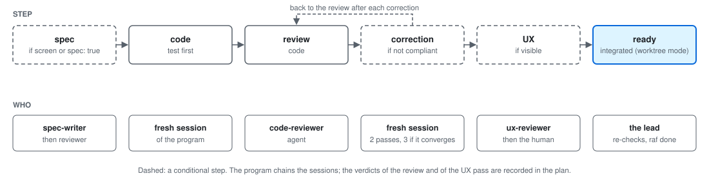
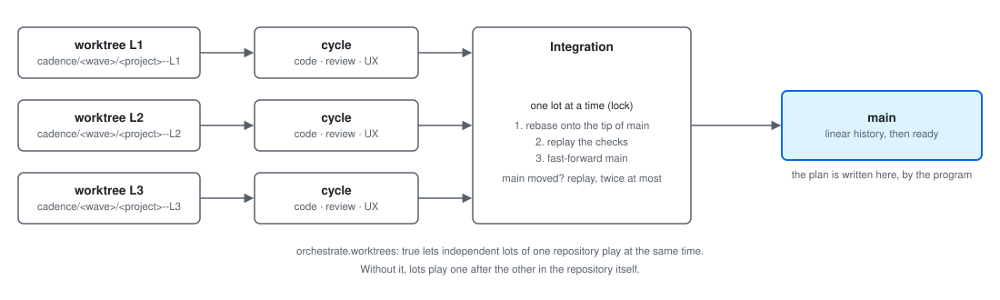
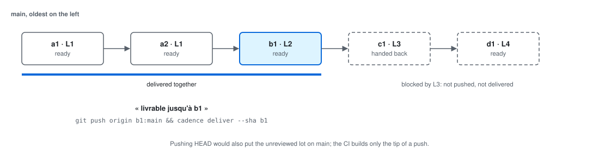
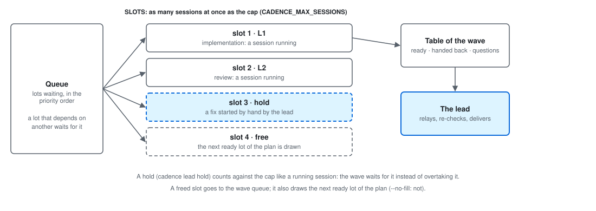

[← cadence](../README.md)

# The notions of cadence, for a human

cadence has a rich vocabulary, faster than its pages. This one explains each notion briefly,
**in the order you meet them**, with four figures; the detail stays in the pages it links, and the
[glossary](#glossary) is the one-line version. Keep one thing: the journey of a lot ([figure 1](#the-steps-of-a-lot)).

## Plan and lot

The **plan** is a file in your repository (`.cadence/raf.yaml`): what is left to do, and done.
Each item is a **lot**: a piece of work finishable in a day or two, with an identifier (`L12`), title,
estimate and status (`todo`, `doing`, `done`, or `dropped`). A commit that belongs to a lot cites it in its subject:
`feat(L12): …`. That link is the whole idea: a commit tells its lot, a lot tells its commits.
`raf` reads and writes the plan; `raf check` lists commits citing no lot. Detail: [raf.md](raf.md).

## Verdicts

A lot is finished not when its code is written but when two independent readers say so, and the plan keeps their word:
the **review verdict** (`raf review`) says the code is compliant, the **UX verdict** (`raf ux`) says the screen is
usable (a `visible` lot). A verdict is recorded by the program (the review) or by the lead (the UX verdict, on the human's word), never by the session that wrote the code. `raf done` is refused while a sub-task is open. Detail: [raf.md](raf.md).

## Session and wave

A **session** is one fresh Claude Code run with a brief and a single job (spec, code, review, fix). It
remembers nothing of the previous one: what it needs is in the brief and the repository. A **wave** is a run of
`cadence orchestrate` over several lots: the program (not a model) starts the sessions, chains each lot's steps, runs
the tests, and prints a table of ready and handed-back lots. A session cannot ask you anything: when stuck it stops and reports; the question comes back through the lead. Detail: [orchestrate.md](orchestrate.md).

## The steps of a lot

<picture>
  <source media="(prefers-color-scheme: dark)" srcset="concepts-lot-dark.svg">
  
</picture>

Inside a wave, a lot goes through these steps, each in a fresh session. Dashed boxes are conditional.

| Step | What happens | Who |
|---|---|---|
| **spec** | For a lot that creates a screen (`screen: page`) or pins down a behaviour (`spec: true`): a mockup and a **sheet** (fields, states, numbered rules), reviewed before any code; acceptance tests are written from it, committed red and locked | the `spec-writer` agent, reviewed by the `ux-reviewer` (mockup) or `code-reviewer` (sheet); the `acceptance-writer` agent writes the tests; the program locks them |
| **code** | Test first, then the code, commits citing the lot; its own tests must pass | a fresh session of the program |
| **review** | Reads the diff against the lot (and the sheet, rule by rule); findings: blocking, major, minor | the `code-reviewer` agent; the program records `raf review` when it is compliant |
| **correction** | If the review is not compliant: a new session fixes the findings, then a new review. Two passes at most, three when findings converge; then the lot is **handed back** | a fresh session; the program counts |
| **UX** | For a visible lot: the screen is opened in a real browser, in each state, captured at 1440 and 390 px | the `ux-reviewer` agent reports; the verdict is **the human's**, or the lead's with `lead.ux: lead` |
| **ready** | In worktree mode the lot is [integrated](#one-worktree-per-lot-and-integration); otherwise (the default) it is ready once its review is compliant; the lead re-checks it, records `raf done`, delivers it | the lead |

Before all that, a lot whose title cites a finding or another lot gets a **precheck** (« already done? »). Small lots ([size](#the-size-of-a-lot)) get a single review pass. Detail: [fonctionnement.md](fonctionnement.md#2-a-lot-inside-a-wave), [spec.md](spec.md).

## The size of a lot

A lot's **size** is read from its estimate, in days, and decides its ceremony. Four words, smallest first:

| Word | When | Effect |
|---|---|---|
| **express** | estimate > 0 and ≤ 0.1 day (`EXPRESS_MAX_ESTIMATE`), no screen, not a spec lot | one session; no precheck, probe or separate review |
| **light** | estimate ≤ `orchestrate.review.threshold` (0.25 day by default) | light-model review (Sonnet by default), minor findings become notes |
| **small** | estimate ≤ 0.5 day, **or** the lot is flagged `quickwin` | a single review, no separate UX pass: `review-small` (code and ergonomics) for a `visible` lot, a code `review` otherwise; a minor finding still gets one fix and a second review, unless also light |
| **full** | anything bigger | the whole cycle of [the steps above](#the-steps-of-a-lot) |

With the default threshold the words nest: express is also light and small, light is also small. `quickwin` (⚡, `raf add --quickwin`) is « small, said by hand », whatever the estimate; `raf quickwins` lists lots of ≤ 0.25 day or flagged ⚡. Detail: « Review sized to the lot » in [orchestrate-cycle.md](orchestrate-cycle.md).

## The test gate

After each writing session the program plays the project's own **gate**: the build (`orchestrate.build`), then the tests
(`orchestrate.test`); « the tests pass » is never taken on trust. Three rules:

- **Already red at the start.** If a test fails, the program replays the suite at the lot's starting sha in a **throwaway copy**
  (a temporary `git worktree`). A test already red is not the lot's fault: no correction; the table lists it apart.
- **Replayed alone.** With `orchestrate.testReplay`, a test red in the whole suite is replayed alone: green alone means a load
  failure, not a defect, so no correction. Without the key, nothing is replayed.
- **A test that reads the plan.** Plan-only commits are crossed when a gate verdict is carried over. A project whose
  tests read `.cadence/raf.yaml` says so with `orchestrate.gate: { readsPlan: true }`, or the gate would miss a break.

A **resume** (`cadence orchestrate --resume`) picks a suspended wave up where it stopped.
Detail: [orchestrate.md](orchestrate.md#orchestrate), [deliver.md](deliver.md).

## One worktree per lot, and integration

<picture>
  <source media="(prefers-color-scheme: dark)" srcset="concepts-worktrees-dark.svg">
  
</picture>

By default a wave plays a repository's lots one after the other. With `orchestrate.worktrees: true`, independent lots play **at the same
time**, each in its own **worktree** (a second checkout, in its own folder) on a branch
`cadence/<wave>/<project>--<lot>`, so sessions never edit the same files. When a lot's cycle ends, the program **integrates** it: one
lot at a time under a lock, it rebases the branch on `main`, replays the checks, and fast-forwards `main`. Only then is the
lot `ready`. If `main` moved meanwhile the rebase is replayed, twice at most, then the lot is handed back. The program writes the plan, not the sessions; a session never commits on another repository's `main` (it uses a `wip/` branch). Detail: [worktrees](orchestrate-worktrees.md#one-worktree-per-lot-orchestrateworktrees-l279).

## Deliverable up to a sha

<picture>
  <source media="(prefers-color-scheme: dark)" srcset="concepts-livraison-dark.svg">
  
</picture>

Lots commit on top of each other on `main`. When a ready lot sits **under** one that is not, pushing `HEAD` would also publish
unreviewed code. The table then says « **livrable jusqu'à `<sha>`** »: the last commit of the highest ready lot with no
unfinished lot beneath it. Ship that:

```sh
git push origin <sha>:main && cadence deliver --sha <sha>
```

`cadence deliver` waits for that sha's CI, deploys, and replays the effect checks: a delivery is finished only when its effect is proved.
Where a gate is declared, `pre-push` refuses a sha with no green `cadence verify --gate`. Detail: [deliver.md](deliver.md).

## Lead and delivery agent

The **lead** is a Claude Code session (`/cadence:lead`) that drives the waves for you: it reads the state of every project
(`cadence lead tour`), proposes lots, starts the waves, relays each question, **re-verifies** what comes back
(git log, tests, build, `raf check`) and delivers. It never codes. The **delivery agent**
(`livreur`) is a subagent given one ready lot: it checks the sha, runs the gate, records `raf done`, pushes and
delivers, then reports in one line. You decide what matters, and the UX verdict unless delegated.
Detail: [lead.md](lead.md).

## Slots and holds

<picture>
  <source media="(prefers-color-scheme: dark)" srcset="concepts-vague-dark.svg">
  
</picture>

The machine and your quota are shared: at most **N sessions run at once**: N is the cap (`CADENCE_MAX_SESSIONS` or `--max-sessions`, 2 by default; never raised by the lead). Each running session occupies a **slot**; a freed slot goes to the next
lot of the wave; a freed slot is also filled at once by the next ready lot of the plan (always with `--continue`, with named lots since L587; `--no-fill` stops it). A session the lead starts by hand (fix, QA pass) is invisible to waves, so
the lead declares it: `cadence lead hold <label>` and lifts it with `cadence lead release <label>`: a **hold** takes a slot that
waves wait for. `orchestrate --status` prints `créneaux libres : 1 sur 3`. Detail: [lead.md](lead.md#lead-hold-and-release).

**Free slots.** The `créneaux libres : N sur M` figure of `orchestrate --status`, `lead tour` and the `cadence-hud` band is:

> M, minus, for each live wave, the smaller of the **common cap** (the lowest cap of any live wave, M if none) and what the wave holds — one slot per lot holding a claude session in worktrees (`lanes`), one per repository otherwise —, minus the unexpired `lead hold`s; never below 0.

A wave with no cap is bounded by M. A dead wave (pid and start time both match) and an expired hold count for nothing. The registry (`src/orchestrate/registry.ts`) and the band (`plugins/cadence-hud/hooks/format.ts`) implement it twice; `test/creneaux-libres-contrat-l598.test.ts` plays both. Not the *vacant lanes* of a wave (`vacantLanes`, L527).

## Escalation

A lot still not compliant after its correction passes would be handed back. A project can ask for one more try
on a stronger model: `orchestrate.escalation: { model: fable }` plays one correction and one fresh review on it first
(absent, nothing changes; it costs part of the lot's budget). If that is not enough, the lot is **handed back** to the lead,
who fixes it, answers, or brings it to you: the question always reaches a human, never a session. Detail: [orchestrate-cycle.md](orchestrate-cycle.md).

## Putting into service and release

Two moments are easy to confuse. **Putting into service** concerns cadence itself: the commands you type must
not run the code a wave is rewriting, so they read a separate copy, updated only by `npm run service -- <sha>`, which refuses a sha
not an ancestor of `HEAD` or whose lots are not `done`. A **release** is a published version: `cadence release patch|minor|major` writes the version
files and the changelog, then prints the lead's steps (tag, gate, push, CI, publish). Detail: [fonctionnement.md](fonctionnement.md#4-putting-cadence-itself-in-service), [releasing.md](releasing.md).

## Glossary

- **plan**: the file `.cadence/raf.yaml` listing the lots; the single source of truth.
- **lot**: one item of the plan, cited by its commits (`feat(L12): …`).
- **verdict**: a reviewer's recorded opinion on a lot: `raf review` (code), `raf ux` (screen).
- **session**: one fresh Claude Code run, one brief, one job.
- **wave**: a `cadence orchestrate` run playing several lots, with a table of ready and handed-back ones.
- **sheet**: the written spec of a screen or behaviour, numbered rules, each tested.
- **gate**: the build and tests played after each session (related ones only in a worktree, since L590; full suite at integration), with the already-red baseline and the replay alone.
- **readsPlan**: `orchestrate.gate` key declaring that a test reads the plan, so plan-only commits are not crossed.
- **worktree**: a second checkout on its own branch, one per lot, so lots play at once.
- **integration**: rebasing a lot on `main`, replaying the checks, fast-forwarding, one lot at a time, before `ready`.
- **ready**: a *wave* word: a lot whose cycle is finished (and integrated) there.
- **tirable**: a *plan* word: a `todo` lot with no open `after` and no shared resource taken.
- **done**: a *plan* status (`raf done`) or, apart, a *wave* run to its end; neither means delivered (`cadence deliver`).
- **handed back**: a lot the wave could not finish, returned to the lead with its cause.
- **deliverable up to**: the sha up to which a delivery is safe, below the first lot not ready.
- **lead**: the session that drives waves, re-verifies and delivers; never codes.
- **delivery agent**: the `livreur` subagent delivering one ready lot, one-line report.
- **express**: the smallest [size of a lot](#the-size-of-a-lot), ≤ 0.1 day, no screen, not a spec lot: one session, no precheck, no separate review.
- **light**: ≤ 0.25 day by default (`orchestrate.review.threshold`): light-model review.
- **small**: ≤ 0.5 day or `quickwin`: a single review, no separate UX pass.
- **full**: bigger than small: the whole cycle.
- **quickwin**: the ⚡ flag, set by hand: small whatever the estimate; `raf quickwins` lists them.
- **git hook**: a git script (`pre-commit`, `post-commit`, `pre-push`), `raf hook install` installs `post-commit` and `pre-commit`; `cadence orchestrate` puts a temporary `pre-push` during a wave and, when a gate is declared, leaves a permanent gate-only `pre-push` (it refuses a push with no green `cadence verify --gate`): keep it. See [raf.md](raf.md).
- **Claude Code hook**: a command Claude Code runs around a tool call, declared in `hooks/hooks.json`, played by `cadence claude-hook retour|attente|pipe`. See [lead.md](lead.md).
- **plan.onWrite**: no hook of git or Claude Code: the `cadence.yaml` command run after each write of the plan, to refresh derived files. See [raf.md](raf.md).
- **mod hook**: a function hook of the `cadence-hud` mod (`plugins/cadence-hud/hooks/`) that draws the band. See [cadence-hud.md](cadence-hud.md).
- **docs-ok**: one notion, three spellings: the command `raf docs-ok`, the key `docs_ok` of a lot (and `.cadence/docs-ok.yaml` when the plan is read-only), the field `docsOk` in the code. It acknowledges a false doc gap. See [raf.md](raf.md).
- **slot**: one place under the cap of simultaneous sessions.
- **hold**: a slot kept by a session the lead started by hand.
- **escalation**: one more correction and review on a stronger model before handing back.
- **service**: the separate copy of cadence the `PATH` commands read (`npm run service -- <sha>`).
- **release**: a published version, made by `cadence release`.
