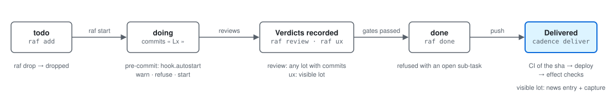
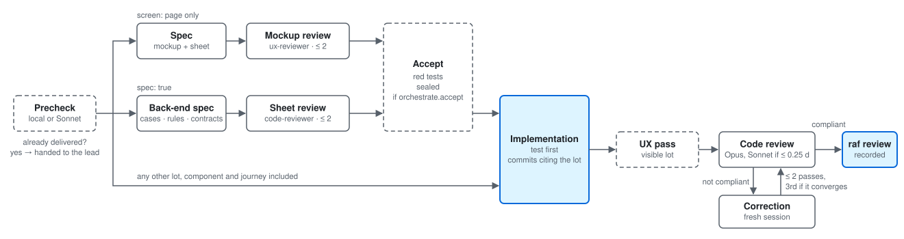
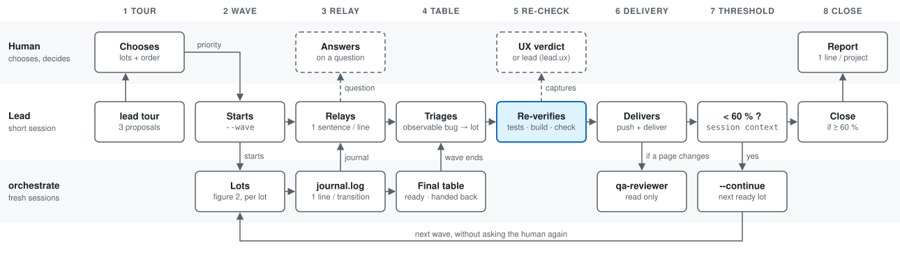
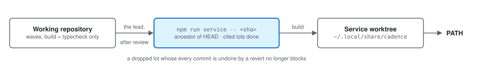

# How cadence works

A versioned plan (`raf`) tied to the commits, waves of fresh sessions driven by a program
(`cadence orchestrate`), a lead that decides and re-verifies, then deliveries proved by their effect.
Four figures go from the isolated lot to the tool itself. Dashed boxes are conditional steps; a
box with a blue outline is where the work is kept or checked.

## 1. The life of a lot in the plan

<picture>
  <source media="(prefers-color-scheme: dark)" srcset="fonctionnement-lot-dark.svg">
  
</picture>

The plan (`docs/plan/raf.yaml`, or the file `cadence.yaml` names) is the single source of truth:
`raf check` reports every commit that cites no lot (unless a motivated `raf ignore` covers it).
`hook.autostart` in `cadence.yaml` sets what the pre-commit hook does with a commit that cites a lot
still `todo`: `warn` (the default), `refuse`, or `start` it in the same commit. `raf done` is refused
while a sub-task is open. A delivery is finished only when its effect checks pass.

## 2. A lot inside a wave

<picture>
  <source media="(prefers-color-scheme: dark)" srcset="fonctionnement-wave-dark.svg">
  
</picture>

A lot without commits yet starts with the **precheck** (unless `orchestrate.precheck: false`; a lot that already has commits is never pre-checked): is the deliverable already there? « Yes » hands the lot back
to the lead; « partial » passes what exists to the implementation. Then:

- `screen: page` only: **spec** (mockup and screen sheet), **mockup review** (`ux-reviewer`, two
  passes at most), then **accept**. `screen: component` and `screen: journey` lots take the ordinary
  path, unless their sheet already exists.
- `spec: true` (a lot with a behaviour to pin down and no screen): **back-end spec** (cases, rules,
  contracts), **sheet review** (`code-reviewer` in sheet mode, two passes at most), then **accept**.
  A mixed lot (a page whose sheet has a `sujet` block) gets both reviews and a single second spec pass.
- **accept** writes the acceptance tests from the sheet, committed red and locked, when the project
  declares `orchestrate.accept`.
- every other lot goes straight to the **implementation**: test first, commits that cite the lot.

After the implementation: the **UX pass** if the lot is `visible` and the project says how to see its
app (`orchestrate.ux`); the **code review** (Opus, Sonnet for a lot of 0.25 day or less); a
**correction** in a fresh session if the review is not compliant, two passes at most, and a third
only when the review converges (the count of blocking + major findings dropped and only one is
left), each followed by a review. A compliant review makes the program record `raf review` itself.
A small lot (estimate of 0.5 day or less, or `quickwin`) has a single review pass, with no separate UX pass:
`review-small` covering code and usability when the lot is `visible`, a code `review` otherwise.

## 3. The lead drives the waves

<picture>
  <source media="(prefers-color-scheme: dark)" srcset="fonctionnement-lead-dark.svg">
  
</picture>

The lead does not code and never commits where a wave runs. It re-verifies itself (git log, tests,
build, `raf check`) before `raf done`, delivers one project at a time, and never pushes above a
handed-back lot (only « livrable jusqu'à `<sha>` »). The UX verdict is the human's, or the lead's
when the parent folder's `cadence.yaml` says `lead.ux: lead`; the human is then asked only at the
slightest doubt. The step-by-step version, with its three lanes, is in [lead.md](lead.md).

## 4. Putting cadence itself in service

<picture>
  <source media="(prefers-color-scheme: dark)" srcset="fonctionnement-service-dark.svg">
  
</picture>

On the cadence repository itself, the `raf` and `cadence` commands of the `PATH` do not read the
working repository's `dist/`: they read a separate worktree under `~/.local/share/cadence`, updated
only by `npm run service -- <sha>`. The command refuses a sha that is not an ancestor of `HEAD` and a
sha whose cited lots are not `done`, so a wave cannot put unreviewed code in service. In the
working repository, `npm run build` is a typecheck only. A `dropped` lot whose every commit is undone
by a `git revert` under the sha no longer blocks.

## Budget of a lot

The budget a wave gives a lot is derived from its estimate, measured on the runs of the project:

| Lot | Budget |
|---|---|
| up to 0.5 day | 450 k tokens |
| 0.5 to 1 day | 750 k |
| beyond | 570 k per day, 750 k at least |
| `screen: page` | 1.3 M at least, or the ordinary budget + 350 k if that is more |
| `spec: true` | ordinary budget + 350 k |
| final review | 65 k reserved |

The final review is always played; the budget bounds the writing passes. A `screen: component` or
`screen: journey` lot takes the ordinary budget, unless its sheet already exists: it then gets the
`screen: page` budget.

## Permanent rules

- **Session cap.** As many sessions or subagents running at once as the cap (2 by default, set by the
  human with `CADENCE_MAX_SESSIONS` or `--max-sessions`). The lead never raises it itself.
- Never two sessions in the same repository at the same time.
- A session cannot ask the human anything: it stops and reports, and the lead brings the question back.
- A sealed acceptance test that contradicts its sheet is corrected by the lead with
  `cadence spec reseal <lot> <test> --reason "…"`, never by editing `acceptation.json`.
- Deliveries and the `raf ux` / `raf review` verdicts belong to the lead, one project at a time.

See also the README's [orchestrate](../README.md#orchestrate) section and
[lead tour](../README.md#lead-tour).
