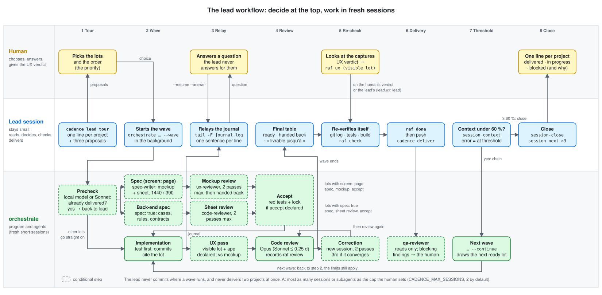

# The lead workflow

The `lead` skill pilots several projects from a parent folder. Its session stays small: it reads
summaries, decides with the human, and leaves the work to fresh short sessions run by a program
(`cadence orchestrate`). This page draws who does what, in three lanes: the **human**, the
**lead session**, and the **`orchestrate` program with its agents**.

<picture>
  <source media="(prefers-color-scheme: dark)" srcset="lead-workflow-dark.svg">
  
</picture>

Dashed boxes are conditional steps (the spec and accept steps run only for a lot with a screen). The skill itself is `skills/lead/SKILL.md`; this page is its
picture, not its source.

## The steps

1. **Tour.** The lead runs `cadence lead tour` (a program, no model) and reports one row per project.
   It proposes three items: finish what is in progress, then drift that blocks a delivery, then ready
   quick wins. It stops and waits: the human picks the lots and the order (`--priority`, or the
   `priority:` list of the parent folder's `cadence.yaml`).
2. **Wave.** The lead starts `cadence orchestrate <project>:<lot> … --wave <id>` in the background.
   For each lot the program runs, in fresh sessions and in this order: `precheck → spec → maquette →
   accept → implement → ux → review`. The steps before the code exist only for a lot that declares
   `screen:` (a visible lot that creates or changes a screen) or `spec: true` (a lot without a screen
   that still has a behaviour to pin down: `precheck → spec → fiche → accept → implement → review`);
   the other lots start at the implementation:
   - **spec**: the `spec-writer` agent draws a static mockup to the project's own style and writes the
     screen sheet (`fiche.yaml`: fields, states, numbered rules), rendered at 1440 and 390 px;
   - **fiche** (a lot with a back-end part: `spec: true`, or a screen lot whose sheet has a `sujet` block):
     the `code-reviewer` agent in sheet mode reviews the back-end sheet (two passes at most, then the lot
     is handed back) unless `orchestrate.fiche: false`; a mixed lot has both reviews, and their findings
     go together to a single second `spec` pass. A lot without a screen has no News entry: the
     hypotheses of its final sheet become one note of the lot each, and the end-of-wave table lists them
     as `hypothèse de la fiche : …` — the lead relays them to the human;
   - **maquette**: the `ux-reviewer` agent reviews the mockup (two passes at most, then the lot is handed
     back) unless `orchestrate.maquette: false`;
   - **accept**: a separate session writes the acceptance tests from the sheet, committed red and locked,
     when the project declares `orchestrate.accept`; without it the step is skipped with a warning;
   - the implementation (test first, commits citing the lot) makes them green without touching them;
   - a UX pass if the lot is `visible` and the project says how to see its app (`orchestrate.ux`); for a
     lot with a sheet it is a conformity pass against the mockup;
   - the code review (Opus; Sonnet for a lot of 0.25 day or less), which also follows each rule of the
     sheet to its test;
   - a correction in a new session if the review is not compliant (two passes at most, each followed by
     a review).

   The program records `raf review` itself once the review is compliant.
3. **Relay.** The lead follows the wave's journal (`tail -n +1 -F .cadence/runs/<id>/journal.log`, one
   line per transition) and tells the human each line in one sentence, with no polling loop. A
   question from a session comes back to the human at once; the answer goes in with
   `cadence orchestrate --resume --answer <project>:<lot> "…"`. The lead never answers in the
   human's place. `--drop` and `--stop-after-current` steer a wave that is running.
4. **Review.** The final table of the wave lists the lots ready, handed back, and the line
   « livrable jusqu'à <sha> » for a ready lot stacked under a handed-back one. Minor findings come back in
   the table: one becomes a lot of its own only if it describes an observable bug.
5. **Re-check.** The lead verifies itself, one project at a time: `git log`, the test suite and the
   build run by the lead, `raf check` clean. A `visible` lot waits for the human to look at the
   UX reviewer's captures: the lead records `raf ux` on the human's verdict, never on its own — unless the parent folder's `cadence.yaml` says `lead.ux: lead`: then the lead forms the verdict from the reviewer's report and its own look at the captures, and asks the human only at the slightest doubt. Then
   `raf done`.
6. **Delivery.** Push (for a « livrable jusqu'à <sha> », that sha alone, never HEAD), then
   `cadence deliver`. After a green delivery that changes what a page shows or what it is served, the
   `qa-reviewer` agent walks the delivered pages in a real browser, reads only, and brings its blocking
   findings to the human. It is not a gate: a finding becomes a new lot.
7. **Threshold and chaining.** Before every new wave the lead reads `cadence session context`. Under
   **60 %** it chains: `cadence orchestrate --continue` draws the next ready lot of the plan, in the
   declared priority, without asking the human « next? ». From 60 % upward, or when the figure cannot
   be read (exit code 2: the band is not loaded, or its figure is stale), it starts nothing. A lot
   that was not handed back ready is reported, not chained over; a question or a UX reservation
   pending on a lot never stops the chain on the other lots.
8. **Close.** `session-close` in each project touched, filtered memory, three lines for next time
   with `cadence session next` (the wave that was about to start comes first), then one line per project
   to the human: delivered, in progress, blocked (and why).

## Permanent rules

| Rule | Why |
|---|---|
| At most **two subagents** running at once, orchestrate sessions included | `cadence orchestrate --status` and `cadence lead tour` print `créneaux libres : N sur 2`; never raise `--max-sessions` above two |
| Never two sessions in the same repository at the same time; the lead does not commit where a wave runs | a wave's lock refuses `cadence deliver` while a lot still works there |
| A locked acceptance test that contradicts the sheet is corrected by the lead with `cadence spec reseal <lot> <test> --reason "…"` (sheet unchanged, lot in progress, outside a wave), then `--resume --answer` for a lot in question, or a new `cadence orchestrate <project>:<lot>` for a lot handed back (`--resume` skips it) | never by a session, never by editing `acceptation.json` |
| Deliveries and the `raf ux` / `raf review` verdicts belong to the lead, one project at a time | never to a subagent, never two deliveries in parallel |
| The UX verdict is the human's unless `lead.ux: lead` (parent `cadence.yaml`, default `human`) | then the lead decides from the report and the captures, and brings any doubt to the human |
| A session cannot ask the human anything | it stops and reports; the lead brings the question back |
| Never push or deliver HEAD above a handed-back lot | HEAD holds code that was not reviewed |
| A plan kept by another tool is read-only for `raf` | its own commands record the lot's state |

## Exit codes

`cadence orchestrate`:

| Code | Meaning |
|---|---|
| `0` | every lot is ready |
| `1` | some lots were handed back to the lead |
| `2` | refused before acting (a precondition failed) |
| `3` | wave suspended (budget or usage limit); `--resume --budget …` continues |

`cadence session context` exits `2` when it cannot prove the figure (no band, several sessions in
the folder without `$CLAUDE_CODE_SESSION_ID`, figure older than two minutes): the lead then treats it
as being at the threshold.

See also the README's [lead tour](../README.md#lead-tour) and [orchestrate](../README.md#orchestrate)
sections.
