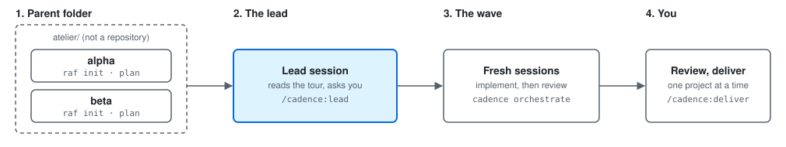

[← cadence](../README.md)

# Start in 10 minutes: one lead, several projects

You keep a folder with a few small projects. A **lead** session looks at all of them, you choose what to
do, and a program runs each lot in fresh sessions. This page takes you from nothing to the first wave.

<picture>
  <source media="(prefers-color-scheme: dark)" srcset="quickstart-dark.svg">
  
</picture>

The commands below were played on a clean Windows 11 machine with WSL (Ubuntu 24.04, L357): about 40 seconds of commands,
29 of them for Node and Claude Code. The rest of the ten minutes is reading and typing.

## Before you start

You need four things; the page says how to check each.

- **Node 22.18 or later** (`node --version`). If you have none: [nvm](https://github.com/nvm-sh/nvm), or the NodeSource
  package of your distribution (`setup_22.x`). Node 20 is not enough.
- **git, with an identity.** Without one, the first `git commit` stops with `empty ident name`:

  ```sh
  git config --global user.name "Your Name"
  git config --global user.email "you@example.com"
  ```

- **Claude Code, installed and logged in.** `claude auth status` must print `"loggedIn": true`. A wave opens
  `claude -p` sessions and stops at the first one with `Not logged in · Please run /login` otherwise.
  Install it from [claude.com/claude-code](https://claude.com/claude-code), then run `claude` once and log in.
- **A test command** for each project (`npm test`, `pytest`, `go test ./...`). The wave runs it after every change.

## Install

```sh
npm install -g @sylad/cadence
cadence --version
```

If npm answers `EACCES: permission denied, mkdir '/usr/lib/node_modules/@sylad'`, your Node belongs to the system.
Give npm a folder of your own, then install again:

```sh
npm config set prefix ~/.npm-global
export PATH="$HOME/.npm-global/bin:$PATH"     # add this line to ~/.bashrc or ~/.zshrc too
npm install -g @sylad/cadence
```

The skills and agents come as a Claude Code plugin:

```sh
claude plugin marketplace add Sylad/cadence
claude plugin install cadence@cadence
```

## The parent folder

The lead works from a folder that holds the projects as sub-folders. The folder itself is not a repository.
Each project is one: give it a plan with `raf init`, a first lot, and the test command, in one commit.
Run the block once per project (here `alpha`, then `beta`):

```sh
mkdir alpha && cd alpha
git init -b main
raf init
raf add "Create hello.txt containing hello" --estimate 0.25
cat > cadence.yaml <<'EOF'
orchestrate:
  test: test -f hello.txt        # passes once the first lot has created hello.txt
EOF
git add -A && git commit -m "chore: init raf"
cd ..
```

What it does: `raf init` writes the plan (`.cadence/raf.yaml`), a commit hook and a `.gitignore` line. The commit
that adds them cites no lot and is no gap: like any commit that touches only the plan files, it is left out of `raf check`
and of the tour's drift column (what `raf init` writes counts as plan files, `cadence.yaml` created in the same commit
with its `orchestrate.test` line included; a code file in it would make it a `commit sans lot` again). `cadence.yaml` is the project's settings file; its single
`orchestrate.test` line is the minimum the wave needs, and without it the tour warns `porte de tests absente`.
The folder is empty, so the gate here is `test -f hello.txt`, which the toy lot satisfies. On a project that already exists,
put its own test command there (`npm test`, `pytest`, `go test ./...`): `npm test` in a folder without `package.json` fails.
The reference for every other key is [orchestrate](orchestrate.md) and [deliver](deliver.md).

Then, from the parent folder:

```sh
cadence lead tour
```

It prints one line per project: lots in progress, drift, next lot, repository state. Expect `alpha · en cours rien ·
dérive aucune · … · prochain L1 Create hello.txt containing hello · dépôt propre`, and the same for `beta`. This is the table the lead reads.

## Start the lead

Open Claude Code in the parent folder and call the skill:

```sh
claude
```

then type `/cadence:lead` (or say « pilot all projects »). The lead runs the tour, reports in a table, proposes three
lots and **waits for your priority**: nothing starts before you answer. [The lead workflow](lead.md) draws every step.

## The first wave

When you pick `alpha:L1`, the lead launches a wave. You can do it yourself, from the parent folder:

```sh
cadence orchestrate alpha:L1 --dry-run
cadence orchestrate alpha:L1 --wave first
```

The first line only prints what would run: each step, its model and its budget. The second runs the lot in fresh
sessions: implement, then review, and hands the lot back to you. From inside a project, write `.:L1` instead of
`alpha:L1` (the project is a sub-folder of the current folder, so `alpha:L1` from inside `alpha` finds nothing).

The sessions of a wave never push and never deliver. You read the table, answer the questions it brings back, then
`/cadence:deliver` ships one project at a time ([deliver](deliver.md)). How waves, budgets and reviews work: [orchestrate](orchestrate.md).

## If it stops

| You see | Cause | Do |
|---|---|---|
| `npm: command not found` | no Node | install Node 22.18+ (above) |
| `EACCES: permission denied, mkdir '/usr/lib/node_modules/@sylad'` | system-owned Node | `npm config set prefix ~/.npm-global` (above) |
| `fatal: empty ident name … not allowed` | no git identity | the two `git config --global` lines (above) |
| `Not logged in · Please run /login` | Claude Code not logged in | `claude`, log in, then `claude auth status` |
| `porte de tests absente` | no `orchestrate.test` | the `cadence.yaml` line of the project block |
| `alpha:L1 … introuvable` | launched from inside `alpha` | use `.:L1` |

A problem that is not here: [open an issue](https://github.com/Sylad/cadence/issues/new/choose) with `cadence --version` and the command you ran.

## Not played

The lead skill and a wave played to the end (review, `raf done`, delivery) were not played on that machine, which was not logged
in to Claude Code; the tour, the dry run and the dry delivery were. Other systems (macOS, native Linux, PowerShell without WSL) were not played either.
