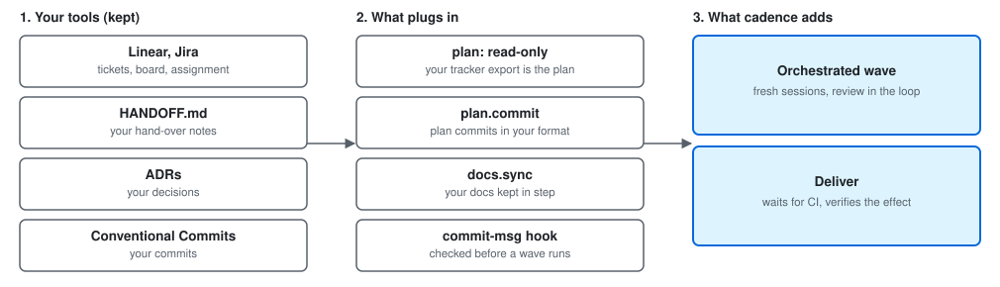

[← cadence](../README.md)

# cadence with your tools

A team that already has a tracker (Linear, Jira), a `HANDOFF.md`, ADRs and a commit convention does not have to choose.
cadence is a few plain files next to the code and a set of commands; each part is optional, and the parts that touch your habits bend to them.

<picture>
  <source media="(prefers-color-scheme: dark)" srcset="with-your-tools-dark.svg">
  
</picture>

## What cadence does not replace

| You have | cadence does not | What it keeps out of |
|---|---|---|
| A tracker (Linear, Jira, GitHub issues) | no board, no assignment, no sprint, no comments, no notifications: its plan is a list of *lots* in a file | the tracker stays where the team agrees what to do and who does it |
| `HANDOFF.md` | writes no hand-over document: `cadence session next "…"` keeps a one-line memo for the next `session start`, nothing more | keep your `HANDOFF.md`; cadence never reads or edits it |
| ADRs | records no decision: a lot's notes are working notes (what was tried, what is left) | decisions that must last stay in your ADRs |
| Conventional Commits (commitlint, husky) | does not impose a commit format: a commit belongs to a lot when it **cites the lot's id**, in the scope (`feat(ENG-12): …`) or anywhere in the message | your `commit-msg` hook keeps judging every commit, including the ones cadence writes (below) |

## What is optional

Nothing here needs the rest. Take one piece, leave the others:

- **`raf`, the plan** (`raf init`, `raf add`, `raf start`, `raf done`): only if you want the plan in the repository. A plan kept by another tool is read as it is, never written (next section).
- **`cadence session start` and `cadence session close`**: a morning and an evening report (lots in progress, commits without a lot, what is uncommitted or unpushed). Skip them if your stand-up or `HANDOFF.md` does that; they change nothing in the repository.
- **`raf hook install`**: warns when a commit cites a lot that is not started. It never blocks a commit unless you set `hook.autostart` to say so.
- **`cadence orchestrate` and `cadence deliver`**: a wave needs a plan it can read, a `raf` plan or a read-only one, and nothing else of the above; it works on a plan cadence never writes. `cadence deliver` is set by its own `deliver:` block and runs without a wave.

## What plugs into what you have

**A plan kept by another tool, read-only.** Point cadence at the file your tracker (or its export script) writes and map its keys. `raf list`, `raf now`, `raf commits`, `raf check`, `cadence session` and `cadence orchestrate` read it; `raf add|start|done|note` refuse and leave the write to your tool. The lot ids are yours (`ENG-12`), so your commits keep citing the ticket:

```yaml
# tracker/tickets.yaml
tickets:
  - key: ENG-12
    summary: Export CSV
    state: In Progress
    points: 2
    opened: 2026-10-20
  - key: ENG-13
    summary: Fix login redirect
    state: Todo
    points: 1
    opened: 2026-10-21
```

```yaml
# cadence.yaml, at the repository root
plan:
  path: tracker/tickets.yaml
  lots: tickets                 # the root key holding the list
  fields:                       # cadence's field: the key in your file
    id: key
    title: summary
    status: state
    estimate: points
    created: opened
  statuses:
    todo: [Todo]
    doing: [In Progress]
    done: [Done]
```

All the keys (`add`, `files`, `ignore`, sub-tasks, `repos`…) are in [docs/raf.md](raf.md#a-plan-elsewhere-or-in-another-format).

**The subject of the plan commits.** A wave commits the plan itself (the lot started, the review recorded). Those commits used to read `plan: L12 démarré (orchestrate …)`, which a commitlint `config-conventional` hook refuses: `plan` is not one of its types (GitHub issue #15). `plan.commit` in `cadence.yaml` sets the subject of all of them, and `cadence orchestrate --dry-run` runs each one through your real `commit-msg` hook before the wave starts:

```yaml
plan:
  path: tracker/tickets.yaml
  commit: 'chore({lot}): {action} (orchestrate {vague})'
```

`{lot}` is required, `{action}` and `{vague}` are optional; the full rules are in [docs/raf.md](raf.md#the-subject-of-the-plan-commits-plancommit-l343). The commits of the work itself are `type(<lot>): …` (`feat(ENG-12): …`), which is Conventional Commits already; a convention that wants something else is stated in the project's `CLAUDE.md`, which every session reads.

**Your existing docs.** `docs.sync` tells cadence which of your documents must change when some code changes, and `raf check` reports a lot that left them behind. It adds no document of its own: the README, the `docs/` pages and the CHANGELOG you already have are the ones it watches.

```yaml
docs:
  sync:
    - paths: [src/**, '!**/*.test.ts']
      docs: [README.md, docs/usage.md]
```

See [Documentation that follows the code](news.md#documentation-that-follows-the-code).

## What it adds

- **Orchestrated waves with an automatic review.** A lead picks the lots; each one goes to a fresh session that writes the tests first, commits and stops. A second, fresh session then reviews the commits against the lot and its notes before the lot can be closed. A red test suite or a missing document is sent back for correction, not found in the pull request. [docs/orchestrate.md](orchestrate.md), [docs/quickstart.md](quickstart.md).
- **A deliver that verifies the effect.** `cadence deliver` waits for the CI of the pushed commit, runs your deploy commands, then replays the checks you declared (a URL that answers, a version that matches, a command that succeeds). A delivery is done when those checks pass, not when the pipeline says "success". [docs/deliver.md](deliver.md).

Start small: a read-only plan and `plan.commit` are enough to see a wave run in a repository that keeps its tracker, its `HANDOFF.md`, its ADRs and its commit convention.
